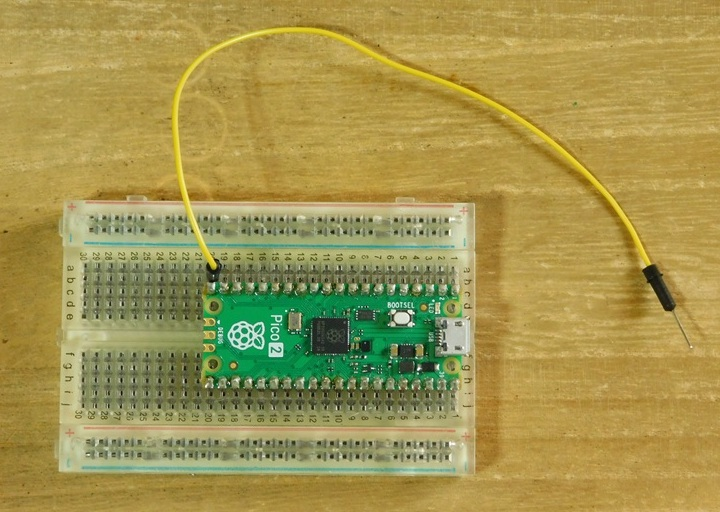
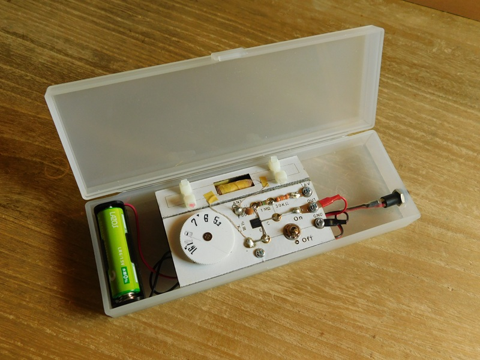
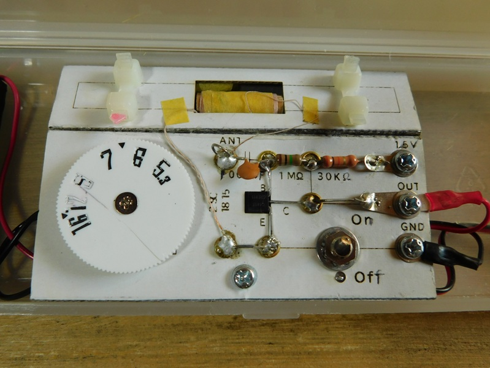
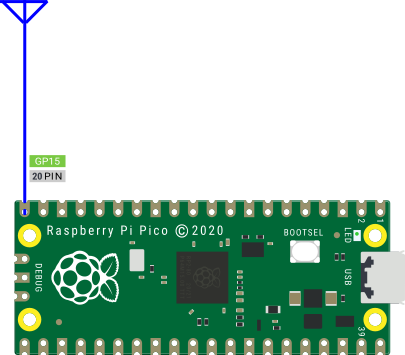
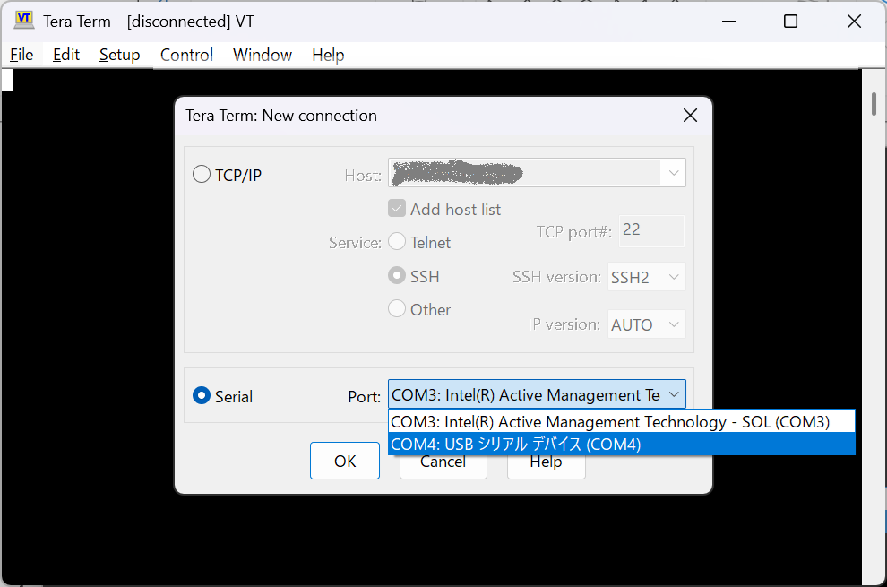
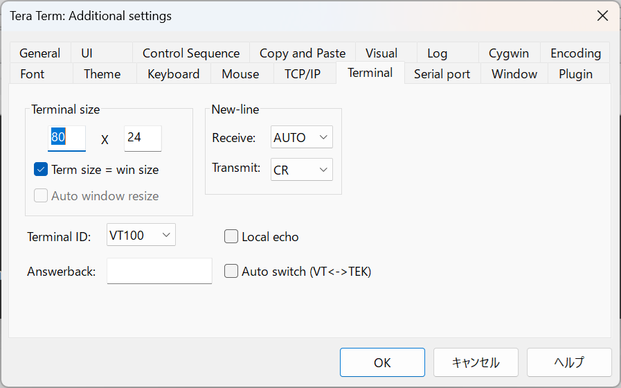
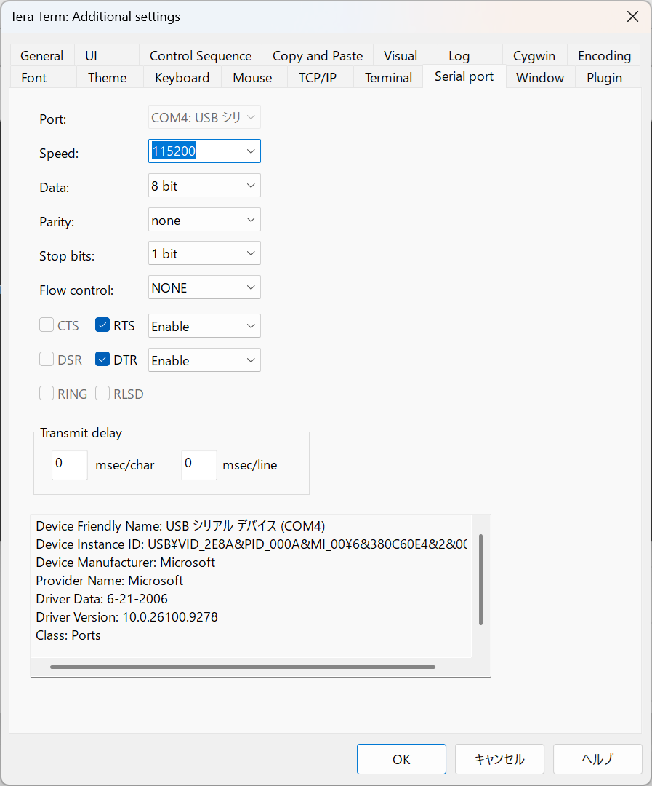
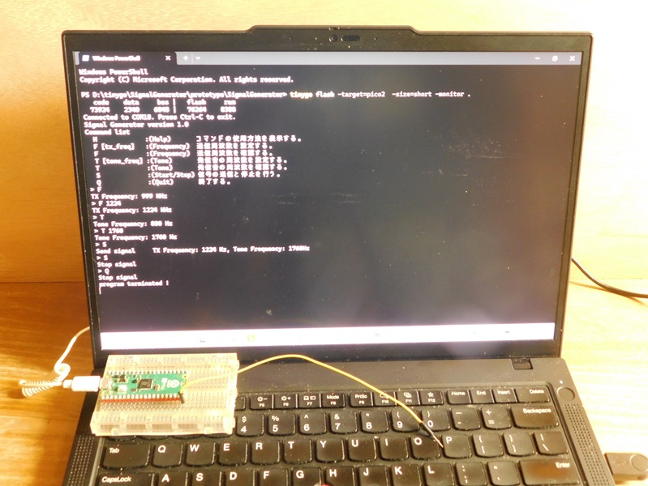
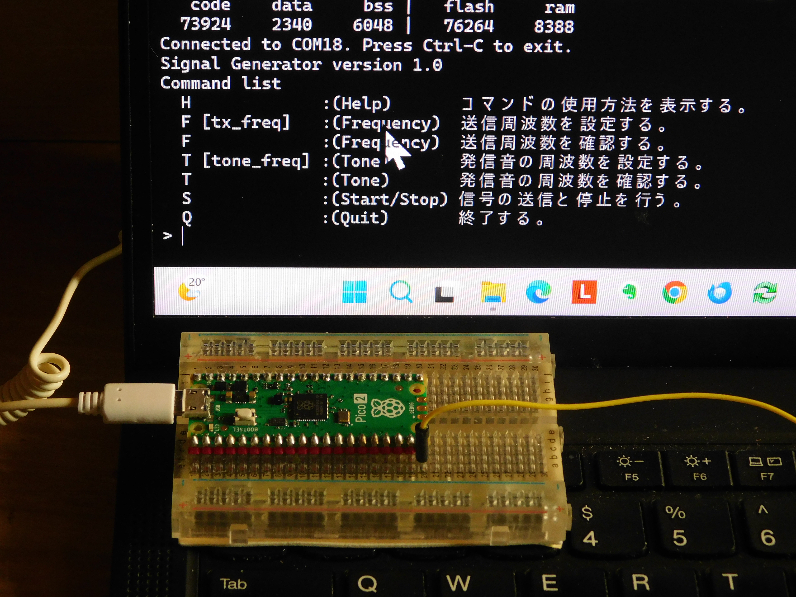
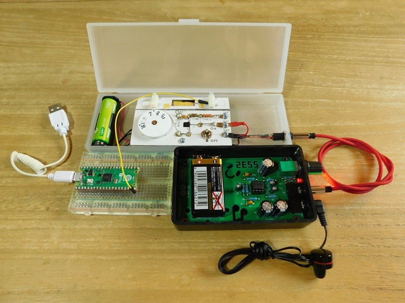

# SignalGenerator
信号発生器(Signal Generator)

<!-- pandoc -f markdown -t html5 README.md -s --embed-resources --standalone -c github-markdown.css -o README.html
 -->

tinygoで、RaspiPicoから設定した周波数の微弱電波を送信する信号発生器を作成しました。 必要な物は、RaspiPicoと1本の導電線だけです。手近にあったパーツで、AMラジオの校正用に作成したものなので、精度は期待しないで下さい。



## 概要

以前、有り合わせのパーツで作成したアナログAMラジオは、コイルとバリコンの容量が合っていなかった様で、受信できない地元放送局があり放置していました。




そこで、受信可能な周波数帯を調べるために、tinygo + RaspiPicoで微弱電波を発生する信号発生器を作成しました。
この信号発生器から、AM帯の微弱電波を出力し、自作AMラジオで受信可能な周波数帯を調べてみました。

## 必要機材

### ハードウェア

* 1 あるいは 2 のマイコンボード
  1. Raspberry Pi Pico、 または、RP2040を搭載した互換品のマイコンボード
  2. Raspberry Pi Pico2、または、RP2350を搭載した互換品のマイコンボード
* 適度な長さの導電線(ジャンパーケーブル等)



### ソフトウェア

* [Tinygo 開発環境](https://tinygo.org/getting-started/install/)  
  プログラムを修正する場合には、Tinygo の開発環境を用意して下さい。
* ターミナルソフト  
  信号発生器(Signal Generator)と通信するために使用します。  
  すでに使用しているターミナルソフトがあれば、それを使って下さい。  
  ここでは、以下の [teraterm](https://teratermproject.github.io/) で説明を行いますので、ターミナルソフトを使っていない方は、このソフトをインストールしておいて下さい。  
  [teraterm](https://teratermproject.github.io/)

## 使用方法

ここでは、事前にコンパイルして生成してあるuf2形式のバイナリーファイルをRaspberry Pi Picoに書込んで、使用する方法を解説します。  

### ファームウェアの書込み

1. 使用するRaspberry Pi Picoに合わせて、以下のuf2ファイルをダウンロードして下さい。

* Raspberry Pi Pico用  
  [./uf2/SignalGenerator.uf2](./uf2/SignalGenerator.uf2)
* Raspberry Pi Pico2用  
  [./uf2/SignalGenerator2.uf2](./uf2/SignalGenerator2.uf2)

2. Raspberry Pi Picoの20Pin(GPIO15)に、適当な長さの導電線(ジャンパーケーブル等)を接続してください。これが出力用アンテナになります。  


ブレッドボード上の Raspberry Pi PicoのGPIO15ピンの位置に、アンテナ線として、ジャンパーワイヤーなどの導電線を接続してください。  

3. 2 で用意したRaspberry Pi Picoの表面にある「BOOTSEL」ボタンを押したまま、USBケーブルでパソコンと接続します。
4. パソコン側に新しいUSBドライブ（マスストレージ）が表示されたら、「BOOTSEL」ボタンを離して下さい。  
5. 先ほどダウンロードした .uf2 ファイルを、そのUSBドライブの中にドラッグ＆ドロップ（またはコピー＆ペースト）して下さい。  
6. ファイルの転送が終わると、Picoが自動的に再起動してプログラムの実行が始まります。

### ターミナルからの操作

この信号発生器(Signal Generator)は、ターミナルを使ってRaspberry Pi Picoにコマンドを送って制御します。  
ここでは、teratermを使って解説します。  

1. teratermを起動し、Raspberry Pi Picoが接続されているシリアルポートを選んで接続して下さい。



2. teratermのメニューバーの Setup --> Terminal を選んで、送受信の改行の設定をして下さい。

```text
New-line
	Receive : AUTO
	Transmit: CR

```


3. teratermのメニューバーの Setup --> Serial port ... を選んで、シリアルポートの通信速度を115200bpsに設定して下さい。



4. 以上の設定が終わったら、エンターキーを押して下さい。Teratermのコンソールに'>'が表示されたら接続完了です。

### コマンドの使用方法

#### H(Help)コマンド
ヘルプメニューを表示します。

```bash
> H
Command list
  H             :(Help)       コマンドの使用方法を表示する。
  F [tx_freq]   :(Frequency)  送信周波数を設定する。
  F             :(Frequency)  送信周波数を確認する。
  T [tone_freq] :(Tone)       発信音の周波数を設定する。
  T             :(Tone)       発信音の周波数を確認する。
  S             :(Start/Stop) 信号の送信と停止を行う。
  Q             :(Quit)       終了する。
```

#### F(Frequency)コマンド

送信周波数の確認と設定を行います。  
F コマンドを引数なしで実行すると、現在、設定されている送信周波数の確認ができます。  
F コマンドに続けて、引数として送信周波数を指定して下さい。  
送信周波数の設定は、KHz単位で指定して下さい。  
設定可能な周波数の上限は、25000KHz(25MHz)くらいです。  
デフォルト設定の送信周波数は、999KHz です。  

```bash
> F
TX Frequency: 999 KHz
> F 1368
TX Frequency: 1368 KHz
```

#### T(Tone)コマンド

発信音の周波数の確認と設定を行います。  
T コマンドを引数なしで実行すると、現在、設定されている発信音の周波数の確認ができます。  
T コマンドに続けて、引数として発信音の周波数を指定して下さい。  
発信音の周波数の設定は、Hz単位で指定して下さい。  
デフォルト設定の発信音周波数は、880Hz です。

```bash
> T
Tone Frequency: 880 Hz
> T 1760
Tone Frequency: 1760 Hz
```

#### S(Send/Stop)コマンド

信号の送信と停止を行います。  
トグル動作になっており、一度、実行すると、送信を開始します。  
もう一度、実行すると、停波します。これを繰り返します。	  

```bash
> S
Send signal     TX Frequency: 1368 Kz, Tone Frequency: 1760Hz
> S
Stop signal
```

#### Q(Quit)コマンド

プログラムを終了します。

```bash
> Q
Stop signal
program terminated !
```

  
コマンドの実行画面

## ファームウェアの再構築

電波を出力するピンを変更する場合は、GPIOのPIN番号とPWMの設定を変更してtinygoで、再コンパイルする必要があります。
tinygoの開発環境がきちんと構築されていれば、特に用意するものはありません。  
まだ、tinygoをインストールしていない場合は、以下のガイドを読んで開発環境を構築してください。  

[Tinygo Quick install guide](https://tinygo.org/getting-started/install/)


#### ソースコードの入手

以下のコマンドで、必要なファイル一式をローカルディレクトリにコピーして下さい。  

```bash
> git clone https://github.com/triring/SignalGenerator.git
> cd SignalGenerator
```

#### GPIO端子の設定

今回のプログラムは、Raspberry Pi Picoの20Pin(GPIO15)をアンテナ出力に設定することを前提としています。  
これ以外のGPIOを使用する場合は、この設定を書き換える必要があります。  
main.goファイルを開いて、設定を書き換えて下さい。

1. 変更場所  
func main()の先頭部分に書かれている**machine.GPIO15**の部分を、以下の表を参考にして、アンテナ出力に使用するGPIO番号に書き換えて下さい。  

```bash
	pwm := pinToPWM[machine.GPIO15]
	// 微弱電波を出力するGPIOピンを指定して、送信機を設定する。
	tx, err := initTransmitter(pwm, machine.GPIO15)
	if err != nil {
		fmt.Printf("failed to configure PWM\r\n")
		return
	}
```

| GPIO  | 0  | 1  | 2  | 3  | 4  | 5  | 6  | 7  | 8  | 9  | 10 | 11 | 12 | 13 | 14 | 15 |
| :---- | -: | -: | -: | -: | -: | -: | -: | -: | -: | -: | -: | -: | -: | -: | -: | -: |
| PWM Ch| 0A | 0B | 1A | 1B | 2A | 2B | 3A | 3B | 4A | 4B | 5A | 5B | 6A | 6B | 7A | 7B |

| GPIO  | 16 | 17 | 18 | 19 | 20 | 21 | 22 | 23 | 24 | 25 | 26 | 27 | 28 | 29 |    |    |
| :---- | -: | -: | -: | -: | -: | -: | -: | -: | -: | -: | -: | -: | -: | -: | -: | -: |
| PWM Ch| 0A | 0B | 1A | 1B | 2A | 2B | 3A | 3B | 4A | 4B | 5A | 5B | 6A | 6B |    |    |

### コンパイル  

以下のコマンドで、プログラムをコンパイルします。  
使用するハードに合わせて、-targetの引数の部分をpicoがpico2に置換えて下さい。  

1. ファームウェアを直接書き込む  
コンパイル後、直接、ファームウェアを書込み、その後、モニターを立ち上げます。  

```bash
> tinygo flash -target=pico  -size=short -monitor .
   code    data     bss |   flash     ram
  76856    2340    6048 |   79196    8388
> tinygo flash -target=pico2  -size=short -monitor .
   code    data     bss |   flash     ram
  73924    2340    6048 |   76264    8388
```
  
ファームウェアの書込み後、モニタが起動した状態

2. ファームウェアファイルの生成  
コンパイル後、ファームウェアのuf2形式のバイナリファイルを生成します。  
生成したuf2ファイルは、**ファームウェアの書込み**を参照して、Raspberry Pi Pico に書き込んで下さい。  

```bash
> tinygo build -target=pico  -size=short -o SignalGenerator.uf2 .
   code    data     bss |   flash     ram
  76856    2340    6048 |   79196    8388

> tinygo build -target=pico2 -size=short -o SignalGenerator2.uf2 .
   code    data     bss |   flash     ram
  73924    2340    6048 |   76264    8388
```

## 使用例  

作成したこのプログラムで、自作AMラジオの受信周波数範囲を調べてみました。  
以下の写真のように、アンテナ出力の導電線をAMラジオのバーアンテナ近くに配置ししました。

  

この状態で出力する周波数を少しづつ変更しながら、バリコンを調整して、受信できる上限と下限の周波数を調べました。
その結果、以下のように、受信範囲がかなり下方にずれていることが判明しました。

|下限周波数|上限周波数|
|---------:|---------:|
|  450 KHz | 1470 KHz |

## 応用例

以下の書籍に、AM受信用周波数マーカーの製作記事が掲載されていました。  


    ラジオ受信バイブル2025  
    第2章　改造・工作編  
      * 周波数が直読できる「AM用周波数マーカー」を作ってみた P88-91
    
  https://www.sansaibooks.co.jp/item/8970/

AM受信用周波数マーカーは、アナログAMラジオで、正確に目的とする周波数に同調させる装置です。  
この記事では、発振部＋変調部で構成されたハードウェアの作成方法が
紹介されていました。  
今回、作成したプログラムでも、以下の操作で同様の機能を実現できます。  

1. Signal Generatorを受信したい周波数に設定し、微弱電波を出力する。
2. アナログAMラジオを、Signal Generatorから出力される電波に同調させる。
3. Signal Generatorの出力を停止する。
4. 目的の放送局が聞こえるか確認する。聞こえない場合は、ラジオの向きやアンテナを調整し、目的の放送局が受信できるようにする。


## Author

* @triring

## License

### 基本ライセンス  

*tinygo_tx* is under [MIT license](https://en.wikipedia.org/wiki/MIT_License).

### 追加ライセンス

[Poul-Henning Kamp](https://people.freebsd.org/%7Ephk/) 氏が提唱しているBEER-WAREライセンスを踏襲し配布する。  

### "THE BEER-WARE LICENSE" (Revision 42)

<akio@triring.net> wrote this file. As long as you retain this notice you
can do whatever you want with this stuff. If we meet some day, and you think this stuff is worth it, you can buy me a beer in return.
Copyright (c) 2024 Akio MIWA @triring  

### "THE BEER-WARE LICENSE" (第42版)

このファイルは、<akio@triring.net> が書きました。あなたがこの条文を載せている限り、あなたはソフトウェアをどのようにでも扱うことができます。
もし、いつか私達が出会った時、あなたがこのソフトに価値があると感じたなら、見返りとして私にビールを奢ることができます。  
Copyright (c) 2026 Akio MIWA @triring  
